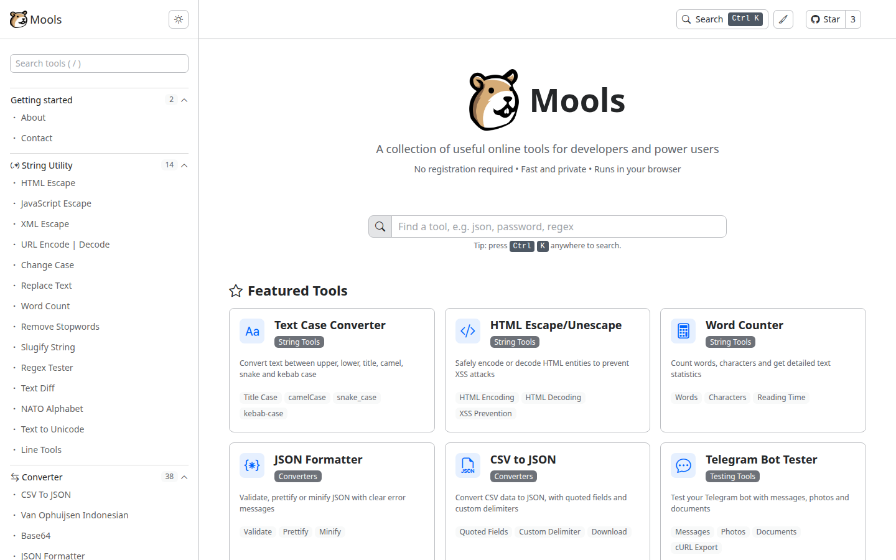
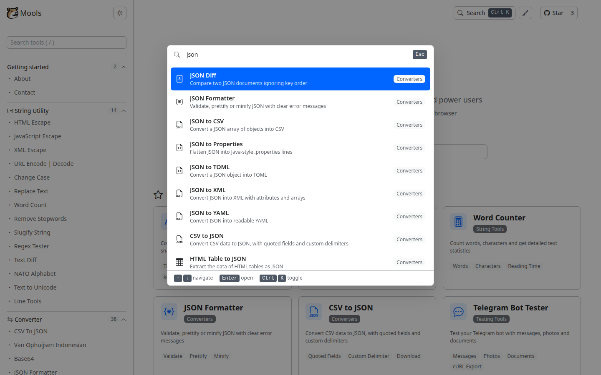
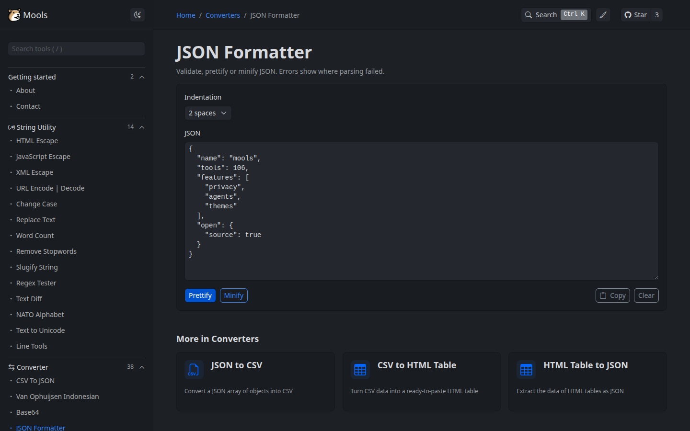
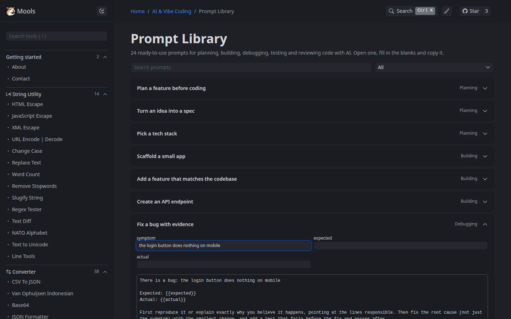
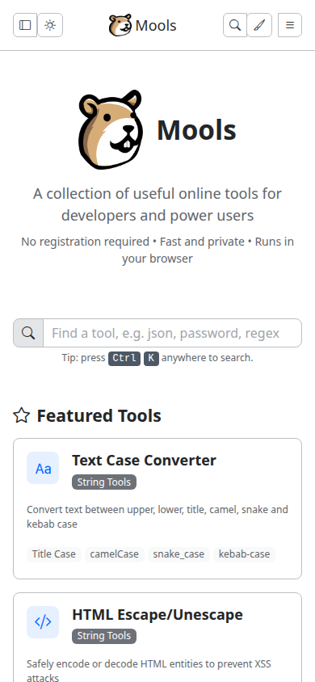

<p align="center">
  
</p>

<h1 align="center">Mools</h1>

<p align="center">
  <strong>119 free developer tools that run in your browser.</strong><br />
  Text, converters, bulk tools, security, SEO, generators, calculators, games and helpers for coding with AI.
</p>

<p align="center">
  <a href="https://maling-it.github.io/tools/"><strong>Open the site</strong></a> ·
  <a href="https://maling-it.github.io/tools/llms.txt">llms.txt</a> ·
  <a href="https://github.com/maling-it/tools/issues/new/choose">Report a bug or request a tool</a>
</p>

<p align="center">
  <a href="https://github.com/maling-it/tools/actions/workflows/deploy.yml"></a>
  <a href="LICENSE"></a>
  <a href="https://github.com/maling-it/tools/releases/latest"></a>
</p>

<p align="center">
  
</p>

## Why Mools

- **Private by design.** Every tool runs in your browser. Your input is never uploaded, there are no accounts and no backend.
- **Works offline.** After the first visit every page is saved in your browser (about 8 MB), and Mools can be installed as an app from your browser menu.
- **Fast to reach.** Press <kbd>Ctrl</kbd> + <kbd>K</kbd> anywhere to search all tools, or use the sidebar and the home page search.
- **Pleasant to use.** Light, dark and automatic themes, three Halfmoon styles, a layout that works on phones and a copy button wherever there is output.
- **Built for AI agents too.** Every tool is also exposed through `llms.txt`, `tools.json`, WebMCP and an MCP server.

## Screenshots

| Command palette | Tool page (dark) |
| --- | --- |
|  |  |

| Prompt library (dark) | On a phone |
| --- | --- |
|  |  |

## What is inside

| Category | Tools | Examples |
| --- | ---: | --- |
| String Tools | 14 | HTML, XML, JS and URL escaping, case converter, regex tester, text diff, word counter |
| Converters | 38 | CSV, JSON, YAML, TOML and XML, Markdown to HTML, SQL formatter, images to PDF, HEIC, Base64, colors, units |
| Security & Privacy | 9 | Password generators, hashes (MD5 and SHA), JWT decoder, HMAC, TOTP, bcrypt, password strength |
| SEO Tools | 2 | Title maker, meta tags |
| Code Generators | 15 | QR codes, barcodes, UUID and ULID, cron, CSS buttons, SVG placeholders, lorem ipsum |
| Calculators | 12 | Concrete, dirt, cap rate, crypto average, chmod, subnets, percentages, stopwatch |
| Bulk Tools | 9 | Bulk text transformer, file hasher, image converter, QR codes, file renamer, find and replace, data extractor, CSV splitter, text chunker |
| Games | 3 | Wordle, Tic Tac Toe, Memory Match |
| AI & Vibe Coding | 9 | AGENTS.md and rules generator, prompt builder and library, repo packer, token counter, DESIGN.md, llms.txt, MCP config |
| Testing Tools | 4 | HTTP status codes, MIME types, URL parser, Telegram bot tester |

Browse the full list on the [site](https://maling-it.github.io/tools/) or in [`src/lib/tools.js`](src/lib/tools.js).

## Development

Requirements: [Bun](https://bun.sh) and Node.js 22.17 or newer.

```bash
bun install
bun run dev      # dev server on http://localhost:6969/tools/
bun run test     # unit tests (Vitest)
bun run test:e2e # browser tests (Playwright), run `bun run build` first
bun run build    # static build into build/
bun run preview  # serve the production build
```

Pull requests run the unit tests, the build and the browser tests, including automated accessibility checks with axe-core (`.github/workflows/ci.yml`). Pushes to `master` run the same checks and then deploy the site to GitHub Pages (`.github/workflows/deploy.yml`). The browser tests open every page in Chrome, so a broken page blocks the deploy.

The browser tests use the Google Chrome installed on your machine; set `CHROME_PATH` to use a different browser.

### Project layout

```
src/lib/          tool logic (pure functions, covered by tests) and the tool registry
src/components/   shared UI: ToolPage, ConvertPage, OutputCard, sidebar, command palette
src/routes/       one folder per tool: <category>/<slug>/+page.svelte
mcp/              the stdio MCP server
docs/             logo and screenshots used by this README
```

### Adding a tool

1. Add an entry to `src/lib/tools.js`. The sidebar, home page, category pages, search, `llms.txt`, `tools.json` and the sitemap all pick it up automatically.
2. Create `src/routes/<category>/<slug>/+page.svelte`. Most tools only need `ToolPage` (text in, text out) or `ConvertPage` (live output).
3. Put the logic in `src/lib` and cover it with a Vitest test.
4. Optional: expose it to agents by adding an entry to `src/lib/agentTools.js`.

## Agent support

Mools is built to be used by AI agents as well as people:

- **`/llms.txt`**, **`/tools.json`** and **`/sitemap.xml`** are generated from `src/lib/tools.js` at build time. `tools.json` also lists the JSON Schema of every callable tool (83 of them).
- **WebMCP**: in browsers that support `navigator.modelContext`, every tool in `src/lib/agentTools.js` is registered on each page, so in-browser agents can call them directly.
- **MCP server**: `bun run mcp` starts a stdio MCP server (`mcp/server.js`). It provides:
  - **Tools**: every tool in `src/lib/agentTools.js`, annotated as read-only. Tools that parse HTML or XML use `jsdom` (an optional dependency); without it they are left out.
  - **Safety**: every call is checked against the tool's input schema and runs in a worker thread with a 15 second limit, so a runaway call is stopped without freezing the server.
  - **Prompts**: the prompt library (`src/lib/prompts.js`, 24 prompts) as MCP prompts, with each `{{placeholder}}` as an argument.
  - **Resources**: `mools://catalog` (all web tools) and `mools://prompts` (the prompt library).

  Tool results are plain text. Errors say what to fix (for example `The input is not valid JSON: ...`), a search without matches says so (`No email addresses found.`), and no tool answers with an empty response.

  ### Using the prompts in Claude Code

  Claude Code turns each MCP prompt into a slash command named `/mcp__mools__<prompt>`, for example:

  ```text
  /mcp__mools__fix-bug              Claude asks you for the symptom, what you expected and what happened
  /mcp__mools__security-audit login-endpoint
  /mcp__mools__commit-message
  ```

  The prompts are listed by `/` completion (24 of them, from `plan-feature` to `accessibility`). Two things to know:

  - Claude Code passes **one word per argument**, so give a single word (or join words with hyphens) or leave the arguments out. Placeholders that stay open are marked at the end of the prompt, and the model takes them from the conversation or asks you.
  - For full sentences, ask Claude to call the `search_prompts` tool with a `values` object, or write the details in your next message.

  Example client config (or generate one with the MCP Config Generator tool):

  ```json
  { "mcpServers": { "mools": { "command": "node", "args": ["/path/to/tools/mcp/server.js"] } } }
  ```

- Pages use labeled form fields and `SoftwareApplication` JSON-LD, so browser agents can also drive the UI.

To add a prompt, add it to `src/lib/prompts.js`; the website and the MCP server both pick it up.

## Roadmap

What is planned is tracked on the [project board](https://github.com/orgs/maling-it/projects/3) and explained on the [Roadmap wiki page](https://github.com/maling-it/tools/wiki/Roadmap). Work is grouped by version milestone ([1.2.0](https://github.com/maling-it/tools/milestone/1), [1.3.0](https://github.com/maling-it/tools/milestone/2), [2.0.0](https://github.com/maling-it/tools/milestone/3)) instead of dates. Ideas are welcome: open a [tool request](https://github.com/maling-it/tools/issues/new?template=tool_request.yml).

## Releasing

Versions follow [Semantic Versioning](https://semver.org/) and every release is listed in [`CHANGELOG.md`](CHANGELOG.md).

1. Add a `## [x.y.z] - YYYY-MM-DD` section to `CHANGELOG.md` and set the same version in `package.json`.
2. Commit with a message such as `Release vx.y.z: bump version and update changelog`.
3. Create a signed tag and push it: `git tag -s vx.y.z -m "Mools x.y.z: summary" && git push origin master --tags`.

The `Release` workflow then checks that the tag matches `package.json` and the changelog, runs the tests and the build, and publishes a GitHub release with the changelog section as its notes and the built site attached. Tags are signed (`git tag -s`, or set `git config tag.gpgsign true`) so GitHub shows them as verified. Versions below 1.0.0 and tags with a suffix such as `-rc.1` are marked as pre-releases.

## Contributing

Bug reports, tool requests and pull requests are welcome. Start with [CONTRIBUTING.md](CONTRIBUTING.md); it covers setup, how to add a tool and how to send a pull request.

- Open an [issue](https://github.com/maling-it/tools/issues/new/choose) using one of the forms (bug, tool request, accessibility report or feedback).
- Security problems go through the [security policy](.github/SECURITY.md), privately.
- Everyone taking part follows the [Code of Conduct](.github/CODE_OF_CONDUCT.md). See also the [accessibility statement](.github/ACCESSIBILITY.md) and [how to get help](.github/SUPPORT.md).
- Sign off your commits (`git commit -s`) and write the subject in the imperative mood, for example `Add CSS minifier tool`.

## License

Mools is released under the [MIT License](LICENSE).

## Built with

[SvelteKit](https://svelte.dev) and Svelte 5, [Bootstrap](https://getbootstrap.com) with the [Halfmoon](https://www.gethalfmoon.com) themes, [Vite](https://vite.dev) and [Vitest](https://vitest.dev). Maintained by [maling-it](https://github.com/maling-it).
